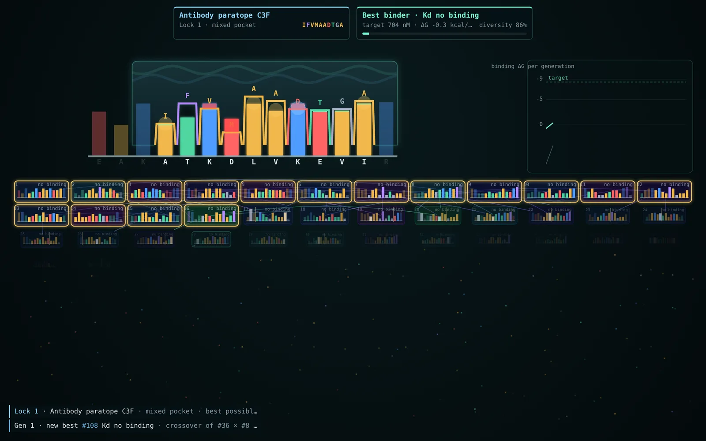
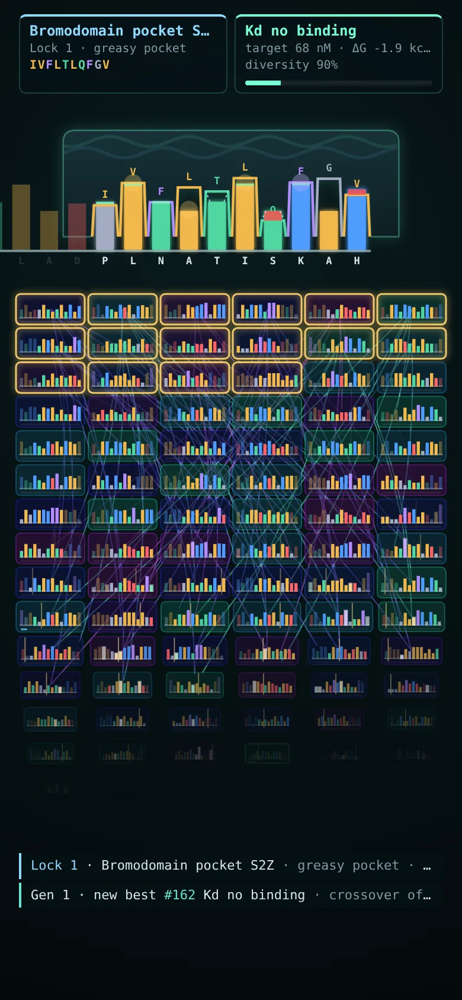

# Affinity

[](https://github.com/ali-raheem/affinity/actions/workflows/ci.yml) [](https://github.com/ali-raheem/affinity/actions/workflows/pages.yml)

**▶ Try it live: [shoryuken.me/affinity](https://shoryuken.me/affinity/)** · mirror on [GitHub Pages](https://ali-raheem.github.io/affinity/) · installable, works offline

<p align="center">
  <a href="https://shoryuken.me/affinity/"></a>
  <a href="https://shoryuken.me/affinity/"></a>
</p>

Watch evolution crack a lock. A random receptor binding pocket sits at the top of the screen; below it, a
population of 96 peptide "keys" evolves to bind it. Each generation the best 16 survive and breed, the rest die,
and their children (crossovers of two survivors, plus a mutation or two) take their places. When the best key
binds within a whisker of the best possible, the lock opens and a new one appears. The same population then has
to adapt to that one.

It runs forever, needs no input, works offline once loaded, and can be installed as an app.

## What you're looking at

- **The receptor** (top): a slab of protein with a groove of 10 sites cut into its underside. Each notch is as
  deep as the cavity at that site, and its rim is coloured by the residue lining it.
- **The best key, docked**: its teeth are residues, as tall as their side chains are big and coloured by
  chemistry. Red overlap is a steric clash, a green cap is a snug fit, and glows show salt bridges (blue),
  hydrophobic contacts (amber), aromatic stacking (violet), charge repulsion (red) and hydrogen bonds (dashed cyan).
- **The population** (grid), ranked best first. Tiles are tinted by lineage, so you can watch one family take
  over. Each generation, gold rims mark the survivors, red tiles dissolve, arcs run from parents to children,
  white flashes are mutations and a gold line marks the crossover point. Then everyone re-sorts.
- **The chart** (wide screens): best and mean binding energy per generation, against the target.

## The model

A deliberately simple but recognisable binding model (`js/chem.js`):

- Real amino-acid properties: Kyte–Doolittle hydropathy, charge at pH 7, side-chain volume, hydrogen-bond
  donors/acceptors, natural abundance.
- Contact energy: electrostatics, the hydrophobic effect (with a desolvation penalty for grease against charge),
  hydrogen bonds, aromatic stacking and cation-π, and shape complementarity (clashes and voids).
- Neighbouring residues interact (crowding, like-charge repulsion, salt bridges, proline kinks), which makes the
  landscape epistatic.
- Keys are 14 residues, longer than the groove, so each docks in its best register.
- ΔG becomes a dissociation constant with Kd = e^(ΔG/RT). The best possible key for each lock is found exactly
  by dynamic programming, and a lock opens within 0.35 kcal/mol of it.
- Mutations prefer chemically similar residues. If the best key stalls for 10 generations, the mutation rate
  spikes for one generation (stress-induced mutagenesis).

### Plateaus are expected

Sometimes the best key sits still for dozens of generations, then jumps. This is a local optimum, not a bug. For
example, on the first lock of `#seed=8b60c666`, the best key stalls from generation 16 to 66. A single M→R
substitution would open the lock, but mutations favour similar residues, so M becomes R only about 0.5% of the
time. While the survivors wait, they score almost the same, so the population drifts (here E→Y), and the escape
ends up taking three steps. Real evolution shows the same pattern (punctuated equilibrium and neutral drift), so
the model leaves it alone.

About 2% of locks never open and are retired after 400 generations (about 21 minutes at 1×).

## Possible future directions

Measured over 600 locks, the current model takes a median of 22 generations per lock (p90 50). 35 of the locks
had a plateau of at least 40 generations, and 11 were retired unopened.

- **Lower `GIVE_UP`** to about 150 (about 8 minutes at 1×), so a hopeless lock moves on sooner.
- **Narrate long plateaus,** for example "Stuck on a local optimum. Waiting for a rare mutation…" after about 15
  stalled generations, so a stall reads as part of the story rather than a freeze.
- **Raise the rare-substitution floor** in `SIMILAR` (`js/chem.js`) from 0.04 to 0.15. This gives a median of 18
  generations (p90 37) and cuts the plateaus of 40+ generations from 35 to 21, at the cost of less realistic
  mutation bias. It doesn't change the retirement count.
- **Make hypermutation bursts radical:** use uniform substitutions at ×2 instead of similar ones at ×4. Plateaus
  of 40+ generations fall from 35 to 28.

Any of these changes how existing `#seed=` links replay.

## Controls

Space pause · +/− speed (½× to 8×) · N next lock · P pocket details · L opened locks · S settings · M sound ·
K key labels · F fullscreen · H hide the interface. The URL carries `#seed=…`, so a link replays the same run.

## Run it

```bash
npm run serve   # python3 -m http.server 8080
npm test        # node --test, no dependencies
```
